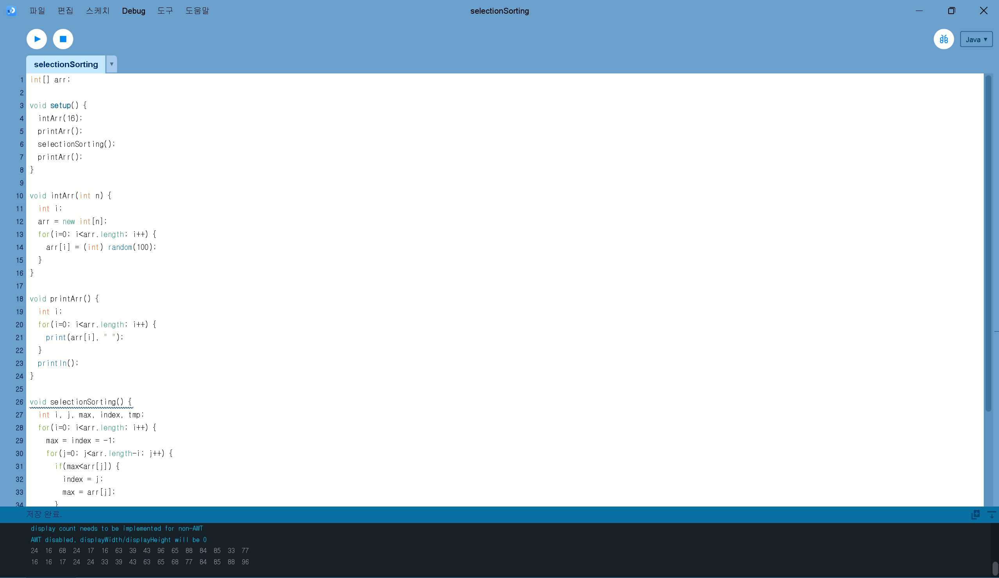
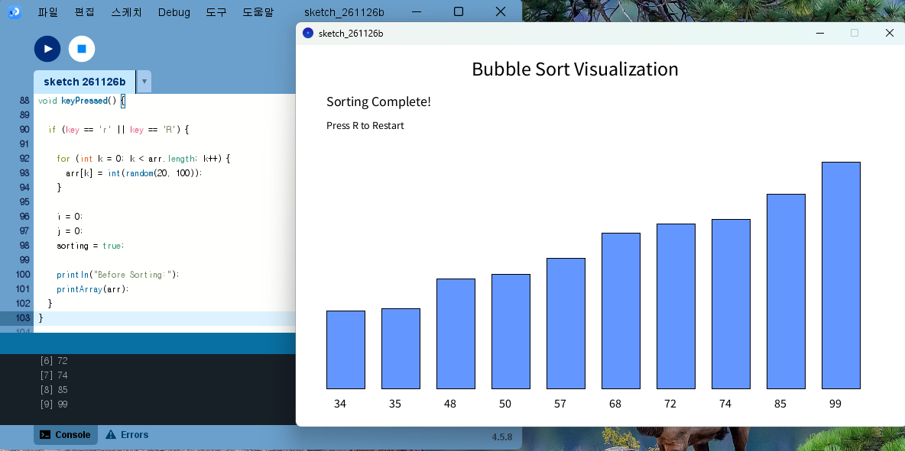
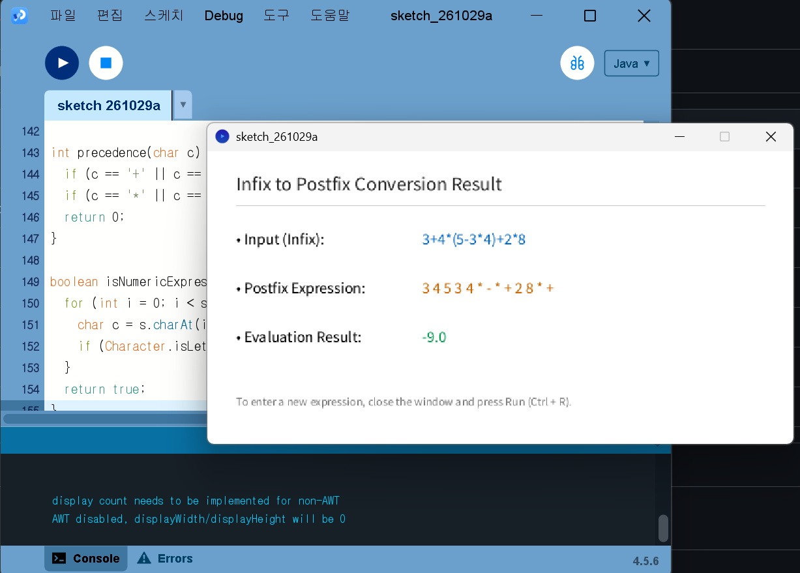
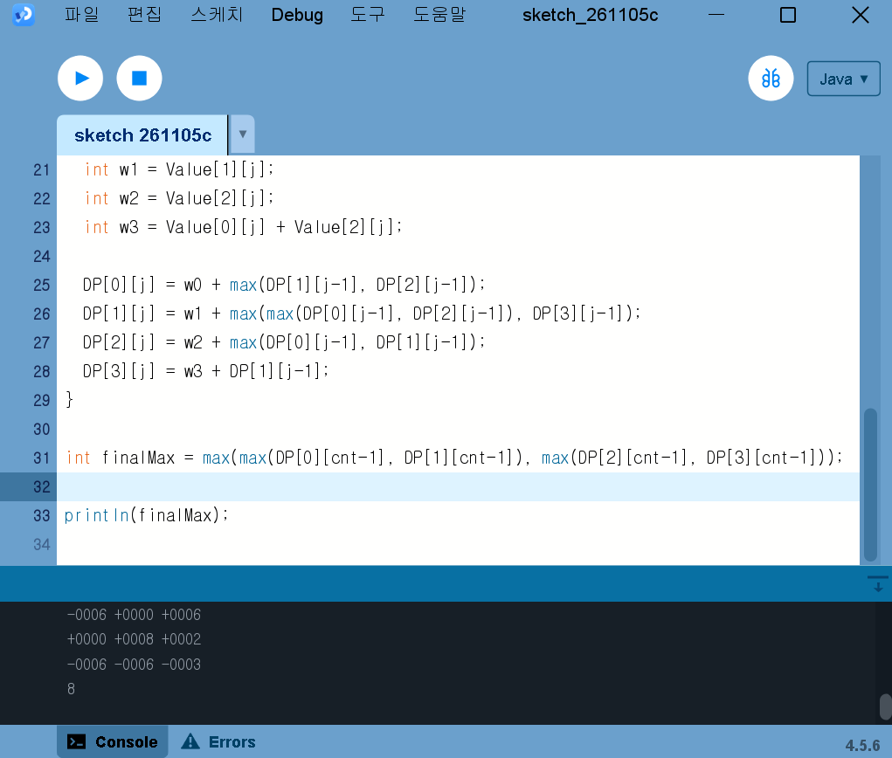

# Alogrithm2026

[SelectionSort](Homework/SelectionSort.pde)

[bubblesort 결과](Homeworkbubblesort.pde)

[insertionsort](Homework/insertionsort.pde)

[postifix](Homework/postifix.pde)

[Pebble Placement](Homework/sketch_261105c.pde)

